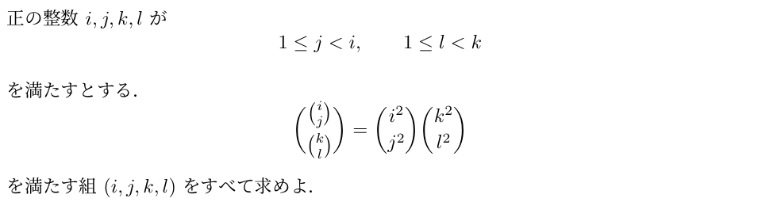

# MathOS｜作問から始まった二項係数の研究

## いま研究している問題

正の整数 $i,j,k,\ell$ が $1\le j<i$、$1\le \ell<k$ を満たすとする。外側の二項係数が定義されるように $\binom{k}{\ell}\le\binom{i}{j}$ とする。

$$
\boxed{
\binom{\binom{i}{j}}{\binom{k}{\ell}}
=
\binom{i^2}{j^2}
+
\binom{k^2}{\ell^2}
}
$$

**この等式を満たす組 $(i,j,k,\ell)$ をすべて求めよ。**

右辺は二項係数の**添字を二乗**したものの**和**です。二項係数そのものの二乗ではありません。

ここでは問題の非自明な範囲を示しています。研究ノートでは非負整数から出発し、端点の場合を排除しています。[定義と境界の場合の整理](https://github.com/corcondor/mathos/blob/research/nested-binomial-2026-11-05/docs/research/nested-binomial/proof_reduction.md)

**研究継続中。元の四変数問題の全解の分類は未完了で、具体的な解もまだ見つかっていません。**  
現在は、部分的な無限族の排除、解が存在するための必要条件、計算による検証、Leanによる一部の形式化を進めています。

[**最新の研究記録：ドラフトPR #1**](https://github.com/corcondor/mathos/pull/1) ·
[**v16 日本語概要**](https://github.com/corcondor/mathos/blob/research/nested-binomial-2026-11-05/docs/research/nested-binomial/PROGRESS_v16_ja.md) ·
[**証明・コード・検証記録の一覧**](https://github.com/corcondor/mathos/blob/research/nested-binomial-2026-11-05/docs/research/nested-binomial/README.md)

## 作問から研究へ

出発点は、受験数学の問題を自分で作ることでした。まず古い形の問題を作り、そこから「もっと難しい問題にしたい」と考えるうちに、自然と添字を二乗する形も考えるようになりました。

その形が予想以上に難しく、なかなか解けずに手こずったため、作問の延長から研究として取り組むことにしました。このリポジトリには、その過程で得られた証明、計算、検証記録を残しています。

### 関連する作問画像

以下は、作成した別問題の画像です。**画像の右辺は「積」で、このページ冒頭の研究対象である「和」の式とは異なります。**

## どこまで分かったか

以下は **2026年11月6日・v16までの記録**に基づく概要です。最新の作業状況は[PR #1](https://github.com/corcondor/mathos/pull/1)で確認できます。

主に $\ell=1,\ j=i-3$ の枝で、解が存在するための条件を絞っています。$n=i$、$A=\binom{n}{3}$、$r=\min(k,A-k)$ とし、$k=r$ と $k=A-r$ の両方を扱います。

- **複数の無限族を排除。** 素数冪や固定した余因子を持つ族などを、証明と完全な有限検証を組み合わせて調べています。
- **不足約数に新しい下限。** $Q=n(n-1)/\bigl(\gcd(n,3)\gcd(n-1,6)\bigr)$、$\delta=Q/\gcd(Q,r^2)$ に対し、必要条件 $\delta\ge13$ を得ています。
- **候補の位置をさらに制限。** $r-3n+3>n^{3/5}/64$ という下側評価と、$n^2-10$ などの二次式の素因数に関する制約を追加しています。
- **第一添字の候補は疎。** v15では、必要条件を満たし得る $n\le X$ の個数に $O(\sqrt{X}\log X)$ の上界を得ています。これは全候補の列挙や全問題の解決ではありません。

これらは特定の枝における必要条件・排除結果です。**この枝全体も、元の四変数問題全体も未解決です。** 必要条件を満たす候補を、元の等式の解とは数えていません。仮定と証明の詳細は[版別の研究記録](https://github.com/corcondor/mathos/blob/research/nested-binomial-2026-11-05/docs/research/nested-binomial/RESEARCH_LOG.md)を参照してください。

## 証明と検証の範囲

- **記述による証明：** 無限範囲を扱う数学的な議論を、版ごとのノートに記録しています。
- **厳密な有限検証：** 理論から有限範囲に帰着した候補を整数計算で確認し、証明書・再現コード・ハッシュを保存しています。単なる範囲内探索と、完全な候補の排除は区別しています。
- **Lean：** 一部の補題と有限証明書には、実行済みの形式検証があります。対象と実行記録は[形式化資料](https://github.com/corcondor/mathos/blob/research/nested-binomial-2026-11-05/docs/research/nested-binomial/v10_formal/README.md)などに明記しています。全問題を形式化したものではなく、並行する形式化も継続中です。
- **v16の新結果：** 記述証明の内部独立点検と厳密整数計算によるものです。新結果全体のLean形式化や外部査読の完了は主張していません。[検証範囲と全記録](https://github.com/corcondor/mathos/blob/research/nested-binomial-2026-11-05/docs/research/nested-binomial/v16_manifest.json)を公開しています。

このREADMEは研究への入口です。個々の結論を使う際は、リンク先の仮定・依存する結果・検証範囲まで確認してください。

## リポジトリの構成

- **研究ブランチ：** [research/nested-binomial-2026-11-05](https://github.com/corcondor/mathos/tree/research/nested-binomial-2026-11-05)  
  二項係数方程式の証明、版別進捗、再現コード、計算証明書、Leanソースを保存しています。masterへはまだマージしていないため、研究資料へのリンクはこのブランチを指しています。
- **master：** この公開用の入口と、MathOSの作問・数学ツール連携プロトタイプ。
- **MathOSの実装を読む：** [作問・検証・新規性判定](README_MATHOS.md) ／ [元のプロトタイプREADME・実行例](docs/math-os-prototype.md)

MathOSの既存コードや実験記録も保持しています。研究を読む人は上のPRと版別概要から、実装を使う人はプロトタイプの文書から進んでください。
